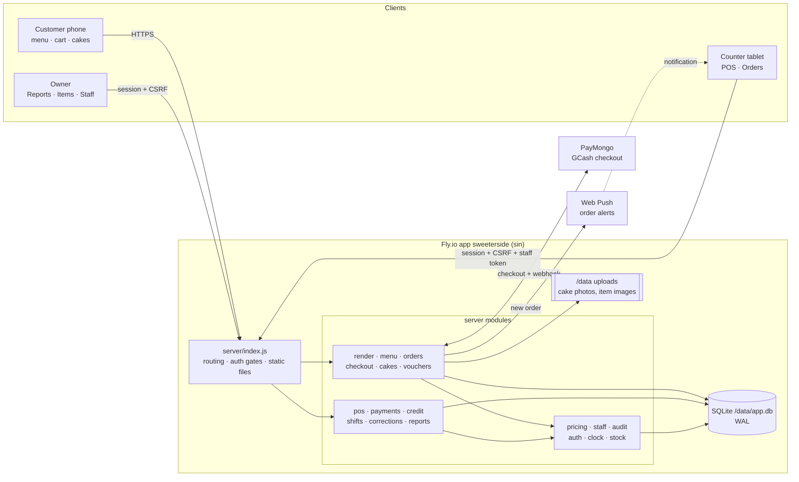
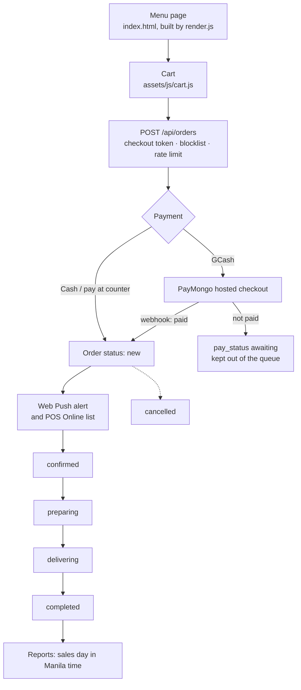
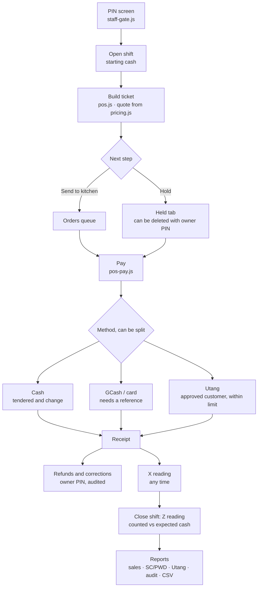
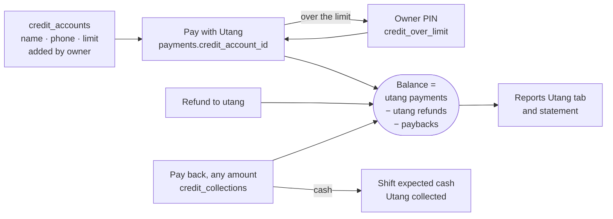

# Sweeter Side — system map

How the menu site, online ordering, cake bookings and the in-store POS fit
together, and how an order moves through them. GitHub draws the diagrams
from the `mermaid` blocks.

Drawn from `main` at c3de03e (Fly v56). `dev-status.md` has the current
state; update this file when the flow or the layout changes.

## 1. The big picture

One Node process serves everything: the customer pages, the admin pages and
the JSON API. It keeps all data in one SQLite file on the Fly volume.

## 2. Who can call what

Each request passes through these gates in `server/index.js` before it
reaches a module.

| Gate | What it checks |
|---|---|
| Public | Menu, About and Cakes pages, `POST /api/orders`, cake bookings, voucher check, PayMongo webhook. Rate limits, a signed checkout token, the phone blocklist, body size limits. |
| Admin session | `requireApiAuth`: a signed-in owner account. Every write also needs the `X-CSRF-Token` header. |
| Staff PIN | `requireStaff`: the `X-Staff-Token` header on top of the admin session. A locked POS answers 423. A wrong PIN is 403 `wrong_pin`. |
| Permission | `staff.authorise()` checks the role (owner, cashier, waiter). Over the limit needs an owner PIN override, which goes in the audit log. |

## 3. Online order flow

A customer orders from the menu. GCash orders wait for PayMongo to confirm
before they reach the kitchen queue.

- **Prices come from the server.** `pricing.js` recomputes every line,
  discount and delivery fee. The browser's totals are ignored.
- **Pre-orders:** `schedule.js` handles orders for a later time, inside
  opening hours.
- **Cake bookings** are a separate request flow in `cakes.js`: size, date
  and a photo upload. The owner answers them from the Cakes page.

## 4. POS flow at the counter

Staff unlock the tablet with their PIN, then build tickets, take payment and
close the shift.

- **Discounts:** SC/PWD and staff discounts are worked out on the server.
  ID numbers are masked except on owner and cashier screens.
- **No double charges:** saves, payments and refunds carry a `request_key`.
  Tabs carry a `version`, so two tablets can't overwrite each other.
- **Online orders on the POS:** `pos-online.js` lists pending online orders
  so the cashier can take payment for them.

## 5. Utang (customer credit)

Utang counts as a sale on the day of the order. The balance is never
stored; it is worked out from the records each time.

## 6. Where the code lives

**`server/`**

| File | What it does |
|---|---|
| `index.js` | Routes, auth gates, static files, CSP headers |
| `db.js` | Schema and additive migrations |
| `pricing.js` | Pure pricing engine, shared by checkout and POS |
| `orders.js` | Online orders, statuses, queue and finished lists |
| `checkout.js` | Signed checkout tokens |
| `paymongo.js` | GCash checkout and webhook |
| `pos.js` | POS tickets, holds, kitchen send |
| `payments.js` | Payments, refunds, receipts |
| `credit.js` | Utang accounts and paybacks |
| `shifts.js` | Shifts, X and Z readings |
| `corrections.js` | Owner fixes to past entries |
| `reports.js`, `csv.js` | Reports and formula-safe CSV |
| `staff.js` | Roles, PINs, permissions, overrides |
| `audit.js` | Append-only audit log |
| `auth.js` | Passwords, sessions, CSRF, login throttle |
| `clock.js` | Manila days and times |
| `stock.js` | Counted items and stock |
| `cakes.js`, `gallery.js` | Cake bookings and photo gallery |
| `render.js`, `seo.js` | Builds `index.html`, sitemap, robots |
| `push.js` | Web Push on `node:crypto` |

**`admin/`**

| File | What it does |
|---|---|
| `common.js`, `admin.css` | Shared helpers, loaded first on every page |
| `staff-gate.js` | PIN screen and owner PIN prompts |
| `pos.html`, `pos.js` | Ticket building, tabs |
| `pos-pay.js` | Pay screen, receipts, readings |
| `pos-credit.js` | Utang list, pay back, statement |
| `pos-online.js` | Online orders on the POS |
| `index.html`, `orders.js` | Orders board |
| `reports.*` | Sales, SC/PWD, Utang, audit |
| `items.*`, `cakes.*`, `vouchers.*` | Menu, cake and voucher editors |
| `staff.*`, `settings.*`, `blocked.*` | Staff PINs, shop settings, blocklist |
| `sw.js`, `push.js` | Service worker and alerts |

**Customer side**

| File | What it does |
|---|---|
| `templates/` | Menu, About and Cakes page templates |
| `index.html` | Generated by the server; never edit it by hand |
| `assets/js/cart.js` | Cart and checkout form |
| `assets/js/menu.js` | Menu browsing |
| `assets/js/cakes.js` | Cake booking form |
| `assets/js/hours.js` | Open and closed times |
| `assets/js/tracking.js` | Analytics, only after consent |

**Everything else**

| Path | What it is |
|---|---|
| `test/` | 27 files, 295 tests on `node:test` |
| `scripts/` | create-admin, icons, VAPID keys, photo cleanup |
| `claude/` | dev-status, pos-plan, security-audit, this map |
| `Dockerfile`, `fly.toml` | Build and deploy to Fly |
| `CLAUDE.md`, `README.md` | Rules and setup |
